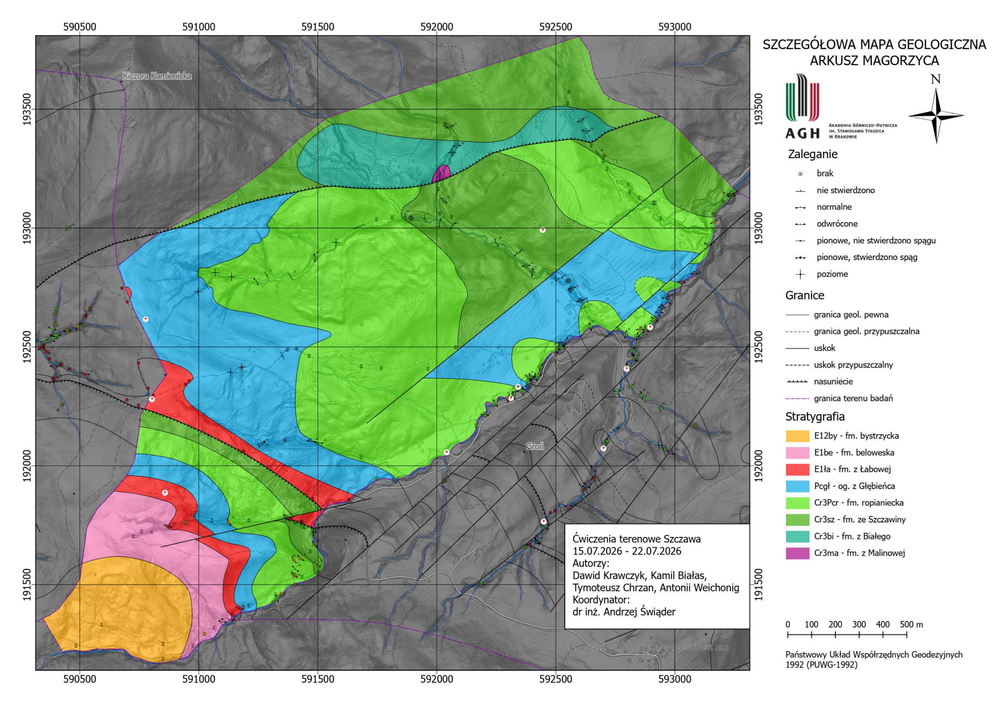
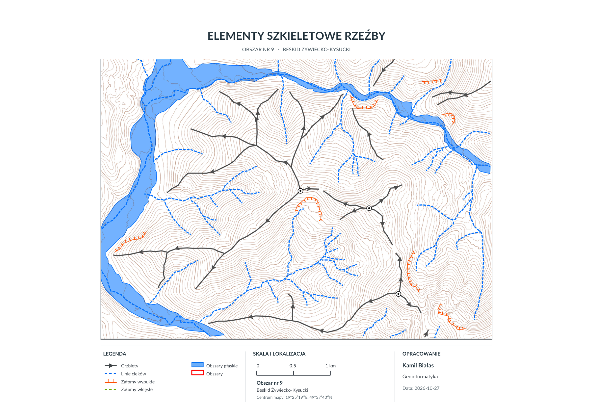

# GIS Projects 🗺️

A collection of my university and personal projects in **Geographic Information Systems (GIS)**, terrain analysis, spatial data interpretation and cartography.

The projects showcase practical workflows, from processing geographic data to interpreting landscapes and presenting the results as maps.

## Geological Field Mapping — Szczawa (Magorzyca Sheet)

**ArcGIS Field Maps · ArcGIS Online · ArcGIS Pro · Field Geology · Geological Cartography**

A collaborative field-mapping project in the **Gorce Mountains, southern Poland**. During geological exercises (15–22 July 2026), the team documented rock outcrops, measured bedding orientation, collected georeferenced observations and interpreted lithostratigraphic units and structural features to produce a detailed geological map.

*Click the map preview to open the original PDF.*

**[Read the detailed project documentation](geological-mapping-szczawa/README.md)** · **[View the geological map (PDF)](geological-mapping-szczawa/maps/szczawa-geological-map.pdf)**

---

## Featured project

### Geomorphological Relief Mapping — Żywiec–Kysuce Beskids

**ArcGIS Pro · LiDAR-derived DEM · Terrain Analysis · Manual Feature Digitization · Cartography**

A detailed geomorphological map of a study area in the **Żywiec–Kysuce Beskids, Western Carpathians (Poland)**. The map identifies important elements of the terrain's relief structure, including ridge lines, drainage lines, convex and concave slope breaks, and flat valley-floor areas.

**Study area:** No. 9 · **Input DEM:** 10 m resolution (LiDAR-derived) · **Map scale:** 1:20,000

*Final cartographic layout. Click the image to open the full map in PDF format.*

**What this project demonstrates:** interpreting a digital elevation model and its terrain derivatives, manually digitizing geomorphological features, and producing a readable thematic map in ArcGIS Pro.

**[Read the detailed project description](geomorphological-relief-mapping/README.md)** · **[View high-resolution map (PDF)](geomorphological-relief-mapping/maps/relief-skeleton-map.pdf)**

---

## Tools & skills

`ArcGIS Pro` · `Digital Elevation Models (DEM)` · `LiDAR-derived elevation data` · `Hillshade` · `Slope analysis` · `Vector editing` · `Geomorphological interpretation` · `Map layout`

## About this repository

Each project will have its own folder containing documentation and deliverables. Additional GIS and spatial analysis projects will be added over time.
