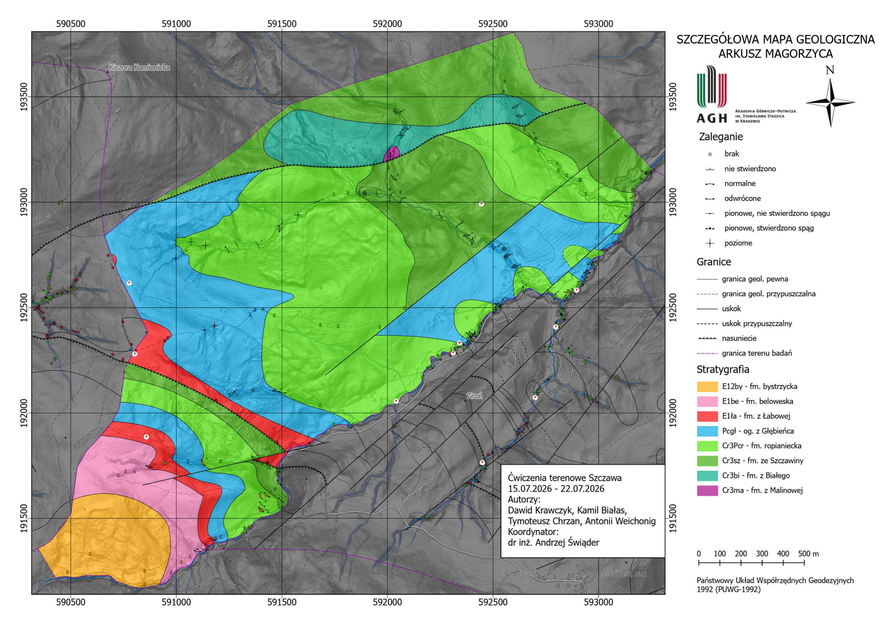

# Geological Field Mapping in Szczawa — Magorzyca Sheet

**Field Geology · Geological Mapping · ArcGIS Field Maps · ArcGIS Online · ArcGIS Pro · Structural Geology · Cartography**

This project presents a **detailed geological map of the Magorzyca study area near Szczawa, southern Poland**, prepared during a collaborative geological field-mapping exercise held **15–22 July 2026**. The goal was to document rock outcrops, interpret lithostratigraphic units and geological structures, and convert field observations into a final GIS-based geological map.

The workflow combined **traditional field geology** (outcrop descriptions, rock identification, bedding measurements and carbonate reaction tests) with a **digital Esri workflow**: field data collection in ArcGIS Field Maps, synchronization via ArcGIS Online, and geological mapping and cartographic production in ArcGIS Pro.

> **Team project:** the final map and geological explanations were prepared collaboratively by Dawid Krawczyk, Kamil Białas, Tymoteusz Chrzan, and Antoni Weichönig. The work is presented here as a team contribution, not as a solo project.

## Final Geological Map

[](maps/szczawa-geological-map.pdf)

*Detailed Geological Map — Magorzyca sheet. The map shows lithostratigraphic units, bedding measurements, interpreted geological contacts, faults and thrust structures. Click the image to open the original PDF.*

**[View the full-resolution geological map (PDF)](maps/szczawa-geological-map.pdf)** · **[Download the geological explanations (DOCX)](reports/szczawa-geological-explanations.docx)**

## 1. Project overview

| Attribute | Detail |
| --- | --- |
| Project | Detailed Geological Mapping — Magorzyca / Szczawa |
| Location | Szczawa, Gorce Mountains, Lesser Poland, Polish Outer Carpathians |
| Geological map sheet context | Łącko (1034), Geological Map of Poland, 1:50,000 reference sheet |
| Study-area size | Approximately **3.69 km²** |
| Fieldwork | **15–22 July 2026** |
| Terrain | Approximately **530 m** at the lower Głębieniec valley to **875 m** at Magorzyca |
| Geological setting | Magura Nappe, Bystrica zone |
| Data collection | ArcGIS Field Maps |
| Cloud synchronization | ArcGIS Online |
| GIS processing and final cartography | ArcGIS Pro |
| Coordinate system shown on map | **PUWG-1992 (Polish national grid)** |

The mapped area covers the **Głębieniec stream valley** and surrounding mountain slopes, with additional small tributary valleys. Physiographically it belongs to the **Gorce Mountains**, near the boundary with the Beskid Wyspowy region.

The terrain is strongly dissected by erosion: steep hillslopes and elongated ridges surround deeply incised valleys. Variations in sandstone and shale resistance contribute to local differences in topographic expression.

## 2. Research objectives

The exercise focused on the following practical geological and GIS tasks:

1. **Identify and document rock outcrops** in the study area.
2. **Describe lithology** and distinguish sandstone, shale, marl and carbonate-rich intervals where recognizable.
3. **Measure bedding orientation** using a geological compass.
4. **Record field observations digitally** as georeferenced data.
5. **Interpret lithostratigraphic boundaries and tectonic structures** using observations and geological context.
6. **Produce a coherent geological map** with geological units, boundaries, structural symbols, legend, scale and references.

## 3. Field data collection and GIS workflow

### Step 1 — Geological reconnaissance

The team explored accessible exposures along stream channels, hillslopes and other field locations. Observations included visible rock type, color, grain size, bedding thickness, sedimentary structures, weathering characteristics and relevant geological contacts.

### Step 2 — Geological measurements

At suitable outcrops, bedding orientation was measured with a **geological compass**. The position and type of individual observations were documented together with field descriptions. The presence of carbonate material was also investigated by recording reactions to **hydrochloric acid (HCl)**.

### Step 3 — Mobile data capture

Outcrop locations, field measurements and observations were entered as georeferenced point records in **ArcGIS Field Maps**. This allowed geological evidence to be tied directly to geographic locations during fieldwork.

### Step 4 — Synchronization and interpretation

Field records were synchronized to **ArcGIS Online** and accessed later on a desktop computer. These observations were organized and used during geological interpretation and digitization in **ArcGIS Pro**.

### Step 5 — Geological boundaries and cartography

The final thematic map presents interpreted **lithostratigraphic units**, measured bedding attitudes and geological structures. The legend distinguishes mapped contacts from inferred boundaries and shows faults or thrusts where interpreted. The completed layout was exported to a high-resolution PDF.


## 4. Geological setting and mapped units

According to the accompanying geological explanations, the area belongs to the **Magura Nappe of the Outer Carpathians**, specifically the **Bystrica zone**. The mapped sedimentary succession represents flysch deposits accumulated from the **Late Cretaceous through the Paleogene**.

The map legend distinguishes the following units:

| Geological age / interval | Unit shown in the map legend | General characteristics described in the report |
| --- | --- | --- |
| Late Cretaceous | **Malinowa Shale Formation** | Variegated red shales with minor sandstone interbeds |
| Late Cretaceous | **Białe Formation** | Thick- and medium-bedded sandstones and local carbonate deposits |
| Late Cretaceous | **Szczawina Sandstone Formation** | Relatively thick sandstone beds, locally coarser-grained |
| Late Cretaceous | **Ropianka Formation** | Rhythmic sandstone–shale flysch succession |
| Paleocene | **Głębieniec Shale Member** (Ropianka Formation) | Interbedded sedimentary rocks including locally carbonate-rich lithologies |
| Early Eocene | **Łabowa Shale Formation** | Predominantly variegated shales |
| Early Eocene | **Beloveža Formation** | Thin- to medium-bedded sandstones and shale-rich flysch |
| Early–Middle Eocene | **Bystrica Formation** | Sandstones, marls and related flysch deposits |

*These descriptions are condensed from the accompanying field report; they are not an independent stratigraphic revision.*

### Structural observations

The geological explanations describe a structurally complicated part of the Magura Nappe, including **imbrication, thrust-related deformation and faults**. The final map differentiates certain and inferred geological boundaries and marks bedding attitudes and interpreted tectonic features.

Because some structural observations concern adjacent geological sheets, the report should be consulted before attributing every described regional structure to the exact polygonal extent of the Magorzyca map.

## 5. Geomorphology and hydrology

The study area is mountainous. The accompanying report gives an approximate elevation range of **530–875 m a.s.l.**, with the highest named summit in the mapped area identified as **Magorzyca**.

The **Głębieniec stream** drains the central study area and receives several smaller tributaries. It subsequently flows to the **Kamienica River**, which drains toward the **Dunajec**. The field report uses the working names **Stromy, Wysypisko, Łagodny and Pstrąg** for four left-bank tributaries of the Głębieniec.

The relationships between local landforms and rock resistance are important in interpreting where outcrops occur, how valleys develop, and why different lithostratigraphic units are expressed differently in the terrain.

## 6. How to read the map

The map uses a gray relief background to provide topographic context, with colored polygons indicating different stratigraphic units. Its legend includes:

- **Lithostratigraphy** — a distinct color for each mapped geological unit.
- **Bedding attitudes** — structural measurements and symbols indicating observed bedding conditions.
- **Geological contacts** — solid and dashed lines for more certain or inferred boundaries.
- **Tectonic structures** — fault and thrust symbols, including inferred structures where appropriate.
- **Study-area boundary** — shown separately from geological contacts.
- **Cartographic references** — north arrow, grid coordinates and distance scale.

Together, the overlaid geological units, structural observations and terrain information illustrate the complex geometry of the local flysch succession.

## 7. Skills demonstrated

- **Field geological mapping:** outcrop recognition, structured observations and geological compass measurements.
- **Mobile GIS:** collecting georeferenced geological measurements using ArcGIS Field Maps.
- **Cloud GIS:** synchronizing field datasets through ArcGIS Online.
- **Desktop GIS:** organizing and interpreting observations in ArcGIS Pro.
- **Structural and stratigraphic interpretation:** distinguishing rock units, contacts, deformation features and associated geological symbology.
- **Geological cartography:** preparing a thematic map combining relief, polygons, measurements, structural lines and explanatory legends.
- **Technical reporting and teamwork:** jointly preparing the map and the accompanying geological explanations.

## 8. Outputs and repository files

```text
geological-mapping-szczawa/
├── README.md
├── assets/
│   └── szczawa-geological-map.png
├── maps/
│   └── szczawa-geological-map.pdf
└── reports/
    └── szczawa-geological-explanations.docx
```

- **PNG:** a preview used directly in the GitHub README.
- **PDF:** the original one-page geological map created in ArcGIS Pro.
- **DOCX:** the group's accompanying geological explanations, including geomorphology, hydrology, stratigraphy and tectonics.

## 9. Limitations and future development

This repository showcases the **final map and written interpretation**, not a fully reproducible geodatabase or the raw ArcGIS Field Maps feature service.

Interpretations depend on the accessible exposures and available measurements. Contacts hidden by soil or vegetation may need to be inferred, and the precision of the resulting unit boundaries is limited by field coverage. The map should therefore be understood as a student field-mapping interpretation rather than an independently verified geological survey.

Possible future extensions include exporting field observations and digitized units to GeoPackage, producing a georeferenced web map, calculating lithostratigraphic unit areas, and comparing bedding orientation distributions using stereographic plots.

## Contributors and academic context

**Contributors:** Dawid Krawczyk, Kamil Białas, Tymoteusz Chrzan, Antoni Weichönig.

**Academic context:** Geological field-mapping exercises in Szczawa, 15–22 July 2026. The accompanying report and map are collaborative academic outputs.

**Original files:** `Szczawa.pdf` (geological map) and `Szczawa.docx` (geological explanations), renamed in this repository to provide descriptive filenames.
