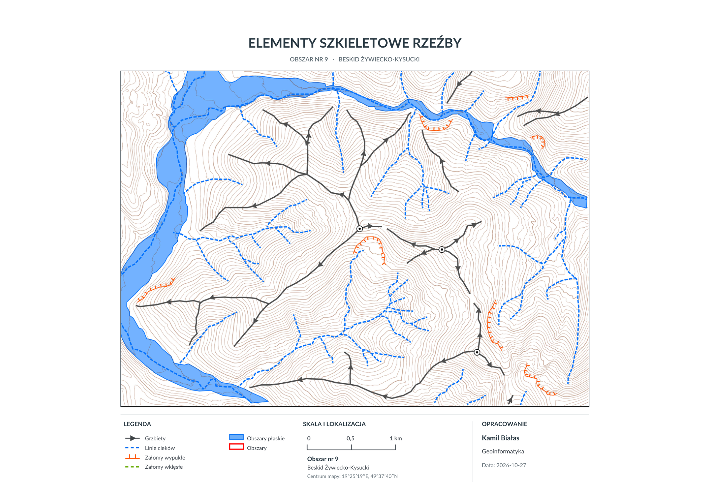

# Geomorphological Relief Mapping — Żywiec–Kysuce Beskids

**ArcGIS Pro · Digital Elevation Model (DEM) · LiDAR · Terrain Analysis · Geomorphology · Cartography**

This project documents the **identification and cartographic representation of the main structural elements of mountain relief** in a selected area of the Żywiec–Kysuce Beskids, part of the Western Carpathians in Poland.

It was prepared as an individual map-based exercise in *Geoinformatics in Geomorphology*. Rather than automatically classifying landforms, the task focused on **interpreting terrain morphology and manually digitizing geomorphological features** based on elevation data and visual terrain derivatives.

## Final map

[](maps/relief-skeleton-map.pdf)

*Final map: “Elementy szkieletowe rzeźby” (Structural Elements of Relief). Click to view the original high-resolution PDF.*

**[Open full map in PDF](maps/relief-skeleton-map.pdf)**

## 1. Study area and purpose

| Property | Description |
| --- | --- |
| Region | Żywiec–Kysuce Beskids (*Beskid Żywiecko-Kysucki*), Western Carpathians, Poland |
| Assigned study area | No. 9 |
| Approximate map-centre coordinates | 19°25′19″E, 49°37′40″N |
| Map scale | 1:20,000 |
| Elevation data | LiDAR-derived digital terrain model, resampled to 10 m |
| Software | ArcGIS Pro |
| Final deliverable | A cartographic map exported to PDF |

### Objectives

The goal was to identify, digitize and present the principal landform components that describe the structure of the local terrain:

- **Ridge lines** — elevated axes separating adjacent valleys and drainage basins.
- **Drainage lines** — lines following valley-bottom depressions and the local drainage pattern.
- **Convex slope breaks** — noticeable changes in slope geometry, such as edges or sharp breaks on hillsides.
- **Concave slope breaks** — transitions associated with changes towards gentler or more concave terrain.
- **Flat areas** — relatively low-slope surfaces, especially in valley bottoms and alluvial terrace settings.
- **Summits and saddles** — point features associated with the ridge network, where identifiable.

These features were interpreted from the terrain model and its visual derivatives, rather than derived from a trained ML model.

## 2. Input data

The coursework provided a LiDAR-derived **digital terrain model (DTM/DEM)** from Polish national geospatial data, resampled to a **10 m grid** for the exercise.

The interpretation workflow used the following terrain representations:

| Input / derivative | Role in the analysis |
| --- | --- |
| Digital terrain model (DEM) | Base elevation information and terrain shape |
| Multidirectional hillshade | Visual recognition of ridges, valleys and landform edges |
| Slope map | Distinguishing gentle valley-floor surfaces from steeper slopes |
| Contours | Tracing relief structure and local curvature of terrain lines |

The source exercise recommended a multidirectional hillshade with vertical exaggeration and a semi-transparent hillshade placed over a slope layer. This creates a combined visual reference for manual terrain interpretation.

## 3. Methodology

### Step 1 — Prepare the terrain visualization

Load the DEM into ArcGIS Pro and use it to generate a multidirectional hillshade and slope raster. Combine the layers so that changes in slope and the three-dimensional terrain pattern remain visible.

### Step 2 — Inspect morphology using multiple terrain cues

Use the hillshade, slope values and contour pattern together. Contour curvature helps distinguish crests from depressions, while slope changes help identify structural transitions and flatter valley surfaces.

### Step 3 — Digitize structural landform elements

Interpret and trace individual vector features over the terrain visualization:

- **Ridges:** follow crest lines and characteristic changes in contour geometry.
- **Drainage lines:** follow valley axes and strongly concave portions of the contour pattern.
- **Slope breaks:** map prominent convex and concave changes in the hillslope profile.
- **Flat valley areas:** delineate gentle bottomland surfaces as polygons.
- **Selected summits and saddles:** place point symbols where the ridge geometry supports them.

### Step 4 — Check the topological consistency

The assignment specifies several quality rules that inform the interpretation:

- Ridge lines should not intersect drainage lines.
- Summits and saddles belong on ridge lines.
- Ridge-line arrows indicate the descending direction of the ridge.
- Convex-break symbols should face downslope.
- Digitized lines should be accurately connected, consistently oriented and visually smoothed.

These rules are useful for avoiding contradictory interpretations in the mapped terrain structure.

### Step 5 — Design and export the final map

Prepare a thematic map layout with distinct symbology for each feature class, a legend, scale bar, study-area description and cartographic attribution. The final map was produced at **1:20,000** and delivered as a **PDF**.

## 4. Reading the map

The final composition uses different colors and line styles to distinguish relief features.

| Map symbol | Meaning |
| --- | --- |
| Dark gray/black lines with arrows | Ridge lines and their downhill direction |
| Blue dashed lines | Drainage lines |
| Orange line symbols | Convex slope breaks |
| Green dashed lines | Concave slope breaks |
| Blue polygons | Flat surfaces, predominantly in valley floors |
| Contour background | Terrain elevation context |
| Point symbols | Selected ridge-associated features |

### Visible spatial patterns

The map illustrates a **branching ridge-and-valley arrangement**. Ridge lines divide the terrain into smaller valley systems, while dashed drainage lines follow topographic depressions. The mapped flat surfaces are concentrated in the larger valley bottoms, contrasting with the more dissected hillslopes. Several convex slope breaks appear on individual valley sides.

These are qualitative observations from the map. The project does not provide a quantitative inventory of landform areas, stream lengths or elevations.

## 5. Skills demonstrated

- Interpretation of LiDAR-derived terrain data.
- Working with elevation rasters, hillshade, slope and contours in ArcGIS Pro.
- Manual digitization of points, lines and polygons.
- Basic topological reasoning and feature orientation.
- Terrain and drainage-network interpretation.
- Thematic cartography: symbol hierarchy, legend design, scale and layout.
- Exporting and documenting a complete GIS map.

## 6. Limitations and possible improvements

**Limitations**

- Landform boundaries are interpreted visually and can involve subjective decisions.
- The 10 m DEM is a resampled dataset; fine-scale microrelief may not be visible.
- The result is a cartographic interpretation, not a geomorphological field validation.
- The repository contains the final map; it does not currently include a fully reproducible geoprocessing workflow or original GIS project files.

**Possible extensions**

- Digitize and export the interpreted geomorphological features as a GeoPackage.
- Compare manually mapped ridges and drainage lines with automated terrain-analysis results.
- Derive landform metrics such as relief amplitude, terrain curvature and drainage density.
- Add a reproducible ArcPy or Python workflow for preparing terrain derivatives.
- Evaluate the mapping against higher-resolution terrain data and field observations, where available.

## 7. Repository contents

```text
geomorphological-relief-mapping/
├── README.md
├── assets/
│   └── relief-skeleton-map.png   # Map preview displayed on GitHub
└── maps/
    └── relief-skeleton-map.pdf   # Original map exported from ArcGIS Pro
```

## Data and academic context

- **Map author:** Kamil Białas.
- **Exercise:** *Geoinformatics in Geomorphology* — “Interpretation of relief elements” (AGH University of Krakow).
- **Terrain data described by the exercise:** Polish LiDAR-derived DTM, resampled to 10 m; original national dataset attributed to GUGiK.
- **Reference:** Course handout, *GwG — Konspekt 3: Projekt 1, Interpretacja elementów rzeźby* (2021).

> The coursework handout describes the recommended workflow and interpretation rules. This repository presents the student's final map output, not the handout or the underlying source dataset.
